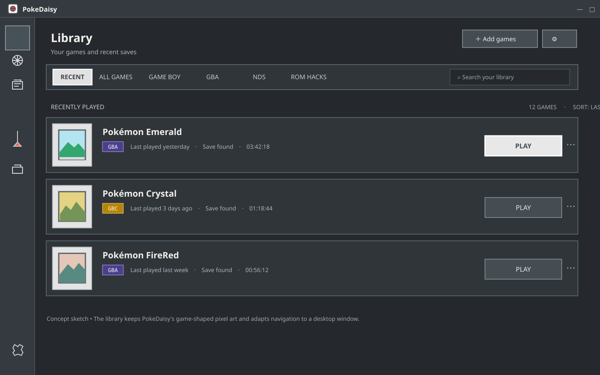
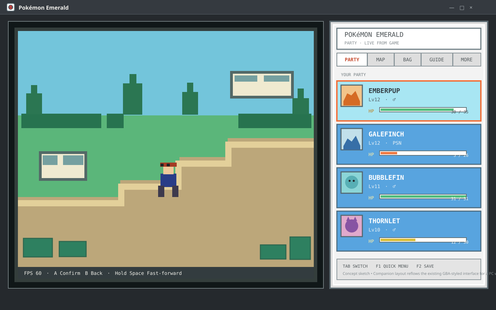

# PokeDaisy Rust Desktop Edition — Design

## Intent

Build a Windows desktop edition of PokeDaisy in Rust, preserving the existing Pokémon companion experience, features, and game compatibility. The repository already has a C/SDL2 Linux frontend and custom libretro cores for GB/GBC, GBA, and DS. All PokeDaisy-owned product behavior is to end up in Rust, including the companion, HUD, quick menu, battle controls, EXPAND, game-specific readers, and field actions. Mature generic emulation engines remain native C/C++ dependencies.

The first release should make PokeDaisy usable on a Windows PC with a keyboard or controller, while preserving user saves and delivering the existing feature set in stages. Linux and macOS can follow after the Windows host is stable. Current PokeDaisy-modified cores are a migration reference and compatibility oracle, not the final home of PokeDaisy product logic.

## Goals

- Rust owns the complete PokeDaisy application and product behavior: launch/library flow, host menus, input mapping, display, audio, frame pacing, save-file safety, save states, fast-forward/rewind, settings, logging, and packaging.
- Use generic libretro-compatible emulator engines for GB/GBC, GBA, and DS, preserving their game support, accuracy, performance, and save-state formats.
- Reimplement the companion, HUD, quick menu, battle controls, EXPAND, game-specific memory readers, and field actions in Rust. The existing modified cores remain available during the migration as the reference implementation for behavior and game compatibility.
- Preserve standard `.sav` / `.srm` battery saves and use the existing settings and data where practical. Never overwrite an existing save without a successful backup.
- Design the Rust boundaries so each supported core can be upgraded independently and Linux/macOS hosts can be added later.
- Reach parity with all player-visible PokeDaisy benefits on desktop through staged releases. No single early release needs to contain every feature.

## Non-goals

- Reimplement mGBA, armGBA, DSperate/melonDS, or another emulator engine in Rust.
- Rewrite the Android app or remove it during the Windows desktop migration; it remains supported as a separate edition and a source of behavioral reference.
- Distribute ROMs or copyrighted game data.
- Replace the generic emulator engines with new Rust emulators.

## Constraints and current architecture

- The existing Linux host is C11 + SDL2 and dynamically loads separate GB/GBC, GBA, and DS libretro cores.
- The current cores contain PokeDaisy-specific integration, not just upstream emulation code. They are required as a temporary behavior oracle while those product features move into Rust; the final design must not depend on their PokeDaisy-specific overlays or game logic.
- The shared 3DS C code contains companion rendering and game-data logic; the Android app has a much larger Kotlin/Compose UI and JNI/C++ integration. Reimplementing all of these at once would delay the Windows port and increase compatibility risk.
- A minimal native ABI adapter is allowed only where an emulator exposes no adequate stable libretro interface. Such an adapter may transfer buffers, events, or memory access; game-specific decisions and player-visible feature logic remain Rust.
- The Windows process must run with ordinary user permissions. Save writes should be atomic where possible, and backups must be retained before a new session changes a save.
- The project is GPL-3.0 and must preserve notices and third-party license terms.

## Approaches considered

1. **Migrate all PokeDaisy behavior to Rust; retain generic native emulator engines (selected).** Port the desktop host and every PokeDaisy-specific feature to Rust, while using existing modified cores as a temporary parity oracle and generic upstream emulators as the final native engines. This meets the full-rewrite goal and retains mature emulator performance. It is the largest feasible path and requires staged differential compatibility checks.
2. **Keep current modified cores permanently.** This is the fastest and least risky way to preserve today's behavior, but leaves PokeDaisy-specific code in C/C++ and does not satisfy the full Rust rewrite requested.
3. **Rewrite emulator engines and PokeDaisy in Rust.** This requires recreating several mature emulators and validating every supported game, hack, save, and state format. It would increase compatibility risk without a clear performance gain, so it is not selected.

## Proposed architecture

- A Cargo workspace under `desktop-rust/`, separate from the current Android and Linux projects during migration.
- `pokedaisy-desktop`: Windows application lifecycle, SDL2 window/input/audio, frame pacing, host menus, and library shell.
- `pokedaisy-libretro`: safe Rust wrapper around the libretro ABI, dynamic core loading, callback ownership, video/audio/input exchange, memory access, and state operations. Keep unsafe code inside this crate and expose checked interfaces to other crates.
- `pokedaisy-game`: ROM identification, game metadata/configuration, per-game memory readers, battle state, companion models, and in-game field actions. Prefer generated/shared source data over manually duplicating tables.
- `pokedaisy-companion`: Rust rendering and interaction for party, bag, battle, map, dex, guide, boxes, Nuzlocke, card, states, achievements, HUD, quick menu, and touch/controller actions. Reproduce existing game-styled layouts and keep rendering independent from window size.
- `pokedaisy-platform`: Windows paths, file dialogs, controller details, and packaging hooks behind platform interfaces.
- Generic emulator binaries are built or obtained from pinned source revisions and packaged beside the application with their license notices. Core selection follows ROM identification, not extension alone.
- During migration, build/reference the current PokeDaisy-patched cores for differential checks. The shipped Rust desktop application must not rely on their companion rendering, game-specific logic, or custom menu hooks. Retire the reference path only after feature and compatibility parity is demonstrated.

## Visual direction and project resources

- The desktop UI should feel like the Android PokeDaisy companion: retain its game-styled pixel panels, tab labels, colors, iconography, and typography. The PC version should improve the experience with layouts that adapt to wide/resizable windows, keyboard and mouse navigation, configurable controller support, a searchable library, and readable high-DPI scaling.
- Reuse the repository's existing art, fonts, shaders, game tables, translations, diagnostics, and generators wherever possible. In particular, keep `app/src/main/assets/fonts/PixelOperator.ttf` for game-styled text and `AtkinsonHyperlegible` for readable supporting text; reuse `gamedata/`, `app/src/main/assets/`, and generated data rather than recreating the source material by hand.
- The library and companion should share the same PokeDaisy visual language. The library can use desktop navigation and denser information, but should still read as PokeDaisy instead of a generic emulator launcher.

## ROM hacks and companion coverage

- Preserve every game and hack currently listed as supported in the project README, including Radical Red, Unbound, Gaia, and the listed GB/GBC/GBA/DS hacks.
- Expand support through reusable per-game/per-hack profiles and engine-aware best-effort detection, reusing the existing compatibility tables, generated data, ROM readers, and fixtures. Do not hide the companion tools solely because a ROM is an unrecognized hack; show the features that can be read safely and clearly mark the unavailable panes.
- Add newly supported ROM hacks incrementally with version-specific profiles and compatibility checks. Keep the README support matrix and in-app capability notice in sync with the actual feature coverage.

## User-visible behavior

These concept sketches show the proposed desktop layout, not final art. They adapt the current library and GBA-styled companion into a resizable Windows application.

### Library

### Gameplay and companion

The gameplay concept puts the original game on the left and the live companion on the right. On narrower screens, the companion can become a panel or overlay, following PokeDaisy's existing one-screen layouts. During the transition, the host may show the existing core-rendered companion as a temporary reference path. Once the Rust companion is active, the host must not draw a duplicate; Rust becomes the sole owner of the companion presentation before the feature-complete desktop release.

## Migration stages

1. **Core compatibility proof:** load generic emulator cores on Windows through a minimal Rust/libretro host; verify video, audio, input, saves, state save/load, and shutdown using diagnostic ROMs.
2. **Desktop host foundation:** library and ROM selection, controller/keyboard mapping, menu, frame pacing, audio, fast-forward, rewind, backups, and data-directory configuration. A playable transition build may use the current patched cores to retain the existing companion while Rust counterparts are developed.
3. **Rust companion foundation:** port the shared data model, game detection, party/bag/battle/map/dex/guide, and visual renderer. Compare live reads and rendered results against current PokeDaisy cores across the supported game fixtures, then make the Rust companion the desktop host's only presentation path.
4. **Rust gameplay integrations:** port HUD, quick menu, EXPAND, in-game battle input, field actions, boxes, state UI, and per-game hooks. Use core-specific fixtures and differential checks; document unsupported cases instead of silently dropping them.
5. **Full desktop feature parity:** port remaining player-visible Android features including achievements, link play, save editing/trading, cheats, library metadata, localization, filters/shaders, and all settings. Ship the feature-complete Windows installer/archive and documentation when every README feature has an owner and acceptance check.
6. **Remove migration references from the shipped path:** use generic pinned cores with Rust host integrations only; retain patched cores only in compatibility test tooling if legally and technically appropriate.

## Compatibility and acceptance criteria

- Existing `.sav`/`.srm` saves load without conversion; new sessions back up changed saves before writing.
- Diagnostic GB, GBA, and DS programs render correctly and accept inputs; no core or ROM content is redistributed beyond the project's permitted diagnostic assets.
- Save-state round trips work with the same core build and are clearly isolated by system/core where formats differ.
- ROMs use the correct core; unsupported extensions produce a clear error and do not create or modify save files.
- SDL/controller hotplug, window resizing, fullscreen, audio-device loss/recovery, and normal quit/resume behavior do not corrupt saves.
- Every player-visible feature in the current project README has a Rust implementation or an explicitly documented limitation before desktop parity is declared; the accepted compatibility matrix covers the currently listed games and hacks.
- Rust-host output and game-state interpretations are compared with the current PokeDaisy implementation using deterministic fixtures where available; known differences are reviewed before dropping reference cores.
- Rust host code is covered by automated tests for file safety, core selection, configuration migration, and callback/error handling; integration checks use the project's diagnostic ROMs and pinned cores.

## Open decisions for implementation

- Choose Rust SDL binding, companion renderer backend, and Windows packaging tool after checking current project/toolchain support; preserve pixel-art quality and avoid adding multiple competing rendering frameworks.
- Set a measurable performance baseline against the current Linux host/core for frame pacing, audio underruns, and memory use; compare on Windows once diagnostic gameplay runs.
- Feature parity is incremental. Keep the complete README feature list as the final target and prioritize stability and compatibility within each milestone.

